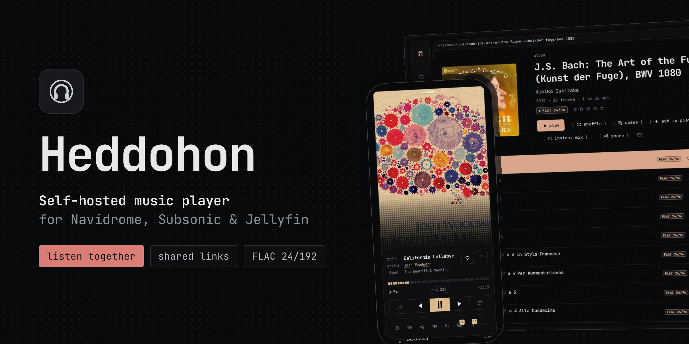

<p align="center">
  
</p>

<p align="center">
  <a href="https://github.com/zorcerer/heddohon/releases"></a>
  <a href="https://github.com/zorcerer/heddohon/actions/workflows/release.yml"></a>
  <a href="https://hub.docker.com/r/zorcererd/heddohon"></a>
  <a href="LICENSE"></a>
</p>

Heddohon is a web music player you host yourself, in front of the Navidrome,
Subsonic or Jellyfin server you already run. Screenshots and a tour are on
[heddohon.app](https://heddohon.app).

## What it does differently

**Your music server stays private.** The browser only talks to Heddohon, which
fetches every byte from the music server and keeps the credentials on the
server. The music server needs no public address.

**Listen together, like a Spotify Jam.** Send a link, and everyone who opens it
hears what you play, as you play it, in their own browser and without an
account. Friends with an account on your music server can add tracks to the
shared queue.

**Share a song, an album or a playlist with anyone.** The link plays the
original file without an account, until it expires or you withdraw it.

**Your listening, kept on your server.** Every play is recorded: top artists
and albums, the hours you listen, what you played on this day in earlier years,
and daily mixes made from it.

**One player across your devices.** The queue and settings follow the account,
and one browser can control another.

**Play anything from the keyboard.** In Terminal, Cmd+K or Ctrl+K opens a
command line: `play` and the name of an album, an artist or a song starts the
best match. Queueing, mixes,
seeking and the volume work the same way.

**Four themes, coloured by the artwork.** Terminal, Liquid, Paper and Phosphor.

## Also

- Original files up to FLAC 24/192, or transcoded to MP3, Opus or AAC.
- Crossfade, ReplayGain, a sleep timer and an equaliser with AutoEq headphone corrections.
- Synced lyrics, instant mixes, internet radio, and casting to Chromecast and AirPlay.
- Scrobbling to Last.fm and ListenBrainz.
- Two-step sign-in with an authenticator app or passkeys, and single sign-on through an OpenID Connect provider (Authelia, Authentik, Keycloak, Pocket ID).
- Desktop apps for Linux and Windows, and an experimental Android app (Android 14 and later).
- AI assistants that speak MCP, such as Claude Code.

## Quick start

```bash
git clone https://github.com/zorcerer/heddohon.git && cd heddohon
docker compose up -d
docker compose logs heddohon
```

The log shows a setup code. Open `http://localhost:3000`, enter the code and
the address of your music server, and sign in with your account on it.

[SETUP.md](SETUP.md) has the rest in order: moving the secret out of the data
directory, and putting Heddohon on the internet behind a reverse proxy.

Configuration by environment variables, Unraid, running without Docker, and the
image tags are in [Configuration](https://github.com/zorcerer/heddohon/wiki/Configuration).
The Android app is on each [release](https://github.com/zorcerer/heddohon/releases/latest),
and [Obtainium](https://apps.obtainium.imranr.dev/redirect?r=obtainium://add/https://github.com/zorcerer/heddohon)
keeps it updated.

<a href="https://ca.unraid.net/apps/heddohon-0bp7lm80vkr69w"></a>

## Documentation

| | |
| --- | --- |
| [Setup](SETUP.md) | Starting it, the setup page, and putting it on the internet |
| [Configuration](https://github.com/zorcerer/heddohon/wiki/Configuration) | Environment variables, reverse proxies, PostgreSQL, Unraid |
| [Apps](https://github.com/zorcerer/heddohon/wiki/Apps) | The desktop and Android apps |
| [Security](SECURITY.md) | Threat model, known gaps, reporting a vulnerability |
| [Contributing](CONTRIBUTING.md) | Reporting bugs, suggesting features, and sending pull requests |

More in the [wiki](https://github.com/zorcerer/heddohon/wiki): audio, architecture and design notes.

## AI disclosure

Written with agentic assistance from Claude. The code and security posture have been
reviewed by me and by multiple AI-assisted audits, documented in [SECURITY.md](SECURITY.md).

## License

[MIT](LICENSE). Music in the header image: Josh Woodward
([CC BY 4.0](https://creativecommons.org/licenses/by/4.0/)) and J.S. Bach's The
Art of the Fugue played by Kimiko Ishizaka
([CC0](https://creativecommons.org/publicdomain/zero/1.0/)).

<p align="center">
  <a href="https://ko-fi.com/zorcerer"></a>
</p>
